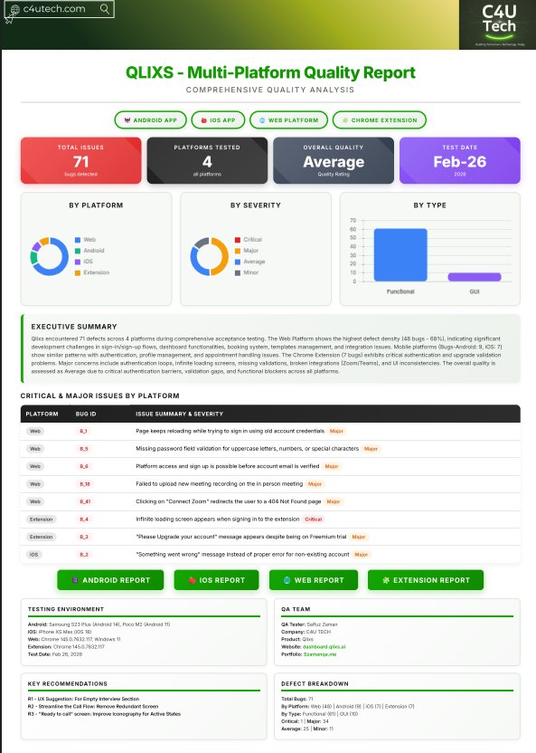

# Enterprise Manual Testing & Multi-Platform QA Audit Portfolio

[](#core-qa-engineering-framework)
[](#case-study-qlixs-multi-platform-quality-audit)
[](#anatomy-of-an-ironclad-bug-ticket)
[-14A800.svg?style=flat-square)](https://www.upwork.com/freelancers/~017c08c6bfe9705ad6?p=1790768827325865984)
[](https://szamanqa.me)

This repository serves as a **professional manual quality engineering portfolio and methodology showcase**, illustrating rigorous multi-platform testing workflows, test documentation, defect triage systems, and comprehensive executive quality reports for modern web and mobile SaaS applications.

---

## 👨‍💻 Lead QA Engineer

**Saifuz Zaman**  
*QA Automation Lead & Software Quality Engineer*  
- **Upwork:** [Top-Rated Freelance Profile (100% Job Success Score)](https://www.upwork.com/freelancers/~017c08c6bfe9705ad6?p=1790768827325865984)  
- **Portfolio & Case Studies:** [szamanqa.me](https://szamanqa.me)  
- **Company:** [C4U TECH](https://c4utech.com)  
- **LinkedIn:** [linkedin.com/in/saifuzzaman-chayan](https://www.linkedin.com/in/saifuzzaman-chayan/)  

---

## 📂 Repository Contents

```text
├── assets/
│   └── qlixs_comprehensive_quality_report.jpg  # Multi-platform quality report visual artifact
├── reports/
│   ├── Qlixs_Comprehensive_Quality_Report.pdf  # Executive multi-platform quality audit PDF
│   └── qlixs-multiplatform-audit.md            # Detailed Markdown report & defect breakdown
├── docs/
│   ├── qa-methodology-handbook.md              # Testing layers (Smoke, MAT, AT, Regression, Exploratory)
│   └── defect-triage-and-lifecycle.md          # Severity vs Priority, bug lifecycle, CNR investigation
└── templates/
    ├── jira-bug-report-template.md             # Standard What-Where-When bug report schema
    └── test-case-template.md                   # Full test case specification spreadsheet template
```

---

## 🏆 Featured Flagship Audit: Qlixs Multi-Platform System

**Product Under Test:** [Qlixs](https://dashboard.qlixs.ai) (AI Scheduling & Workflow SaaS)  
**Target Environments:** Web, Android App, iOS App, Chrome Extension  
**Full Audit Documentation:** [`reports/qlixs-multiplatform-audit.md`](reports/qlixs-multiplatform-audit.md) | [Download PDF](reports/Qlixs_Comprehensive_Quality_Report.pdf)  

### Audit Overview:
- **Total Defects Isolated:** **71 Defects** across 4 platforms.
- **Defect Density Distribution:** Web: **48** (67.6%) | Android: **9** (12.7%) | iOS: **7** (9.9%) | Extension: **7** (9.9%).
- **Classification:** **61 Functional Defects** (85.9%) vs. **10 GUI / Visual Defects** (14.1%).
- **Severity Breakdown:** **1 Critical**, **34 Major**, **25 Average**, **11 Minor**.

### High-Impact Defect Highlights:
| Platform | Bug ID | Severity | Defect Summary | Impact |
| :--- | :---: | :---: | :--- | :--- |
| **Extension** | `B_04` | **Critical** | Persistent infinite loading spinner upon submitting credentials. | 100% blocker for extension users. |
| **Web** | `B_01` | **Major** | Infinite reload loop when logging in with existing credentials. | Prevents access to existing accounts. |
| **Web** | `B_06` | **Major** | Full platform access permitted before email verification link is clicked. | Bypasses user onboarding security. |
| **Web** | `B_41` | **Major** | *"Connect Zoom"* button routes user to broken `404 Not Found` page. | Third-party OAuth integration failure. |
| **Extension** | `B_03` | **Major** | *"Please Upgrade your account"* paywall appears on valid Freemium trial. | Blocks legitimate trial usage. |
| **iOS** | `B_02` | **Major** | Generic *"Something went wrong"* alert on non-existent account lookup. | Degraded user onboarding experience. |

---

## ⚙️ Core QA Engineering Framework

### 1. Multi-Tiered Testing Phases
Testing is applied in structured layers, preventing wasted engineering hours by verifying foundational stability first:

1. **Smoke Testing (Sanity):** Quick verification of core functionalities (app launch, login, navigation, primary checkout) to ensure the build is not fundamentally broken ("on fire").
2. **Minimal Acceptance Testing (MAT — The Happy Path):** Validating all user stories with 100% positive data to ensure smooth, intended user workflows.
3. **Full Acceptance Testing (Full AT — Exhaustive Edge-Case Testing):** Stressing the application with negative checks, extreme boundaries, and equivalence partitioning (EP & BVA) to uncover system-breaking flaws.
4. **Regression Testing:** Complete verification of adjacent features after bug fixes to ensure code changes have not introduced new defects.
5. **Exploratory Testing:** Heuristic-driven, unscripted testing utilizing intuition and domain expertise to expose complex race conditions and state mismatches.

---

### 2. Network Resilience & Real-World Condition Testing

Software must gracefully manage intermittent and degraded connectivity:
- **Mobile Testing:** Conducting tests on real mobile data (switching across **2G/EDGE, 3G, and 4G/5G**) to evaluate timeout handlers, retry policies, and offline data persistence.
- **Browser Network Throttling:** Utilizing Chrome DevTools to simulate **Slow 3G** (500 Kbps / 2000 ms RTT) and packet-loss conditions to verify button debouncing, skeleton loaders, and non-blocking background synchronization.

---

### 3. Anatomy of an Ironclad Bug Ticket

Every bug logged in Jira or GitHub Issues follows the strict **What, Where, When** format:

```text
Summary: [What Happened] on [Where It Occurred] when [User Action / Condition]
```

- **Pre-conditions:** Prerequisites required to reach the defect state.
- **Steps to Reproduce:** Clean, numbered, step-by-step instructions including exact test data.
- **Expected vs. Actual Result:** Explicit technical contrast of behavior.
- **Environment:** OS, device model, browser version, and application build number.
- **Attachments:** Timestamped videos, annotated screenshots, and network console traces.

#### ⚖️ Severity vs. Priority Matrix:
- **Severity** = Technical impact on system stability and data integrity.
- **Priority** = Business urgency to deploy a fix.

| Scenario | Severity | Priority | Business & Engineering Rationale |
| :--- | :---: | :---: | :--- |
| **Crash upon tapping "Buy Now"** | **HIGH** | **HIGH** | System broken & revenue immediately halted. |
| **Company logo inverted/misspelled on home** | **LOW** | **HIGH** | Technically harmless, but unacceptable brand embarrassment. |
| **Crash on tapping hidden developer button 50 times** | **HIGH** | **LOW** | Fatal crash, but standard users will virtually never encounter it. |
| **Minor 2px alignment gap on privacy policy** | **LOW** | **LOW** | Cosmetic polish scheduled for future routine sprint. |

---

### 4. Defect Closure & Retest Protocol

When a developer marks an issue as "Fixed", QA adheres to this verification workflow:
1. **Confirm Build Deployment:** Verify the fix commit is active on the test environment.
2. **Direct Reproduction Retest:** Follow original steps using identical test data.
3. **Adjacent Regression Sweep:** Test connected features to ensure no side-effects were introduced.
4. **Resolution Documentation:** Record verification evidence (screenshots, build number, test timestamp) before moving ticket to **CLOSED**.

---

## 📊 Executive Quality Audit Artifact

<p align="center">
  
</p>

*Figure 1: Full-page executive quality analysis for Qlixs across Android, iOS, Web, and Chrome Extension ([Download Official PDF](reports/Qlixs_Comprehensive_Quality_Report.pdf) | [Read Full Breakdown](reports/qlixs-multiplatform-audit.md)).*

---

## 🛠️ Testing Toolkit & Environment

- **Defect & Project Management:** Jira, Linear, GitHub Issues, Confluence, TestRail, Notion  
- **Inspection & Network Analysis:** Chrome DevTools (Console, Network Throttling, Storage, DOM Breakpoints)  
- **API & Backend Validation:** Postman, Charles Proxy, Swagger  
- **Cross-Platform Devices:** Windows 11, macOS, Android (Samsung S23+, Poco), iOS (iPhone)  
- **Automation Complement:** Playwright, Cypress, Selenium WebDriver, Cucumber BDD  

---

## 📬 Contact & Engagements

Need dedicated QA support, test strategy design, or a pre-release quality audit?  
- **Upwork:** [Hire on Upwork](https://www.upwork.com/freelancers/~017c08c6bfe9705ad6?p=1790768827325865984)  
- **Direct Portfolio:** [szamanqa.me](https://szamanqa.me)  
- **Email:** [contact.szaman@gmail.com](mailto:contact.szaman@gmail.com)  
