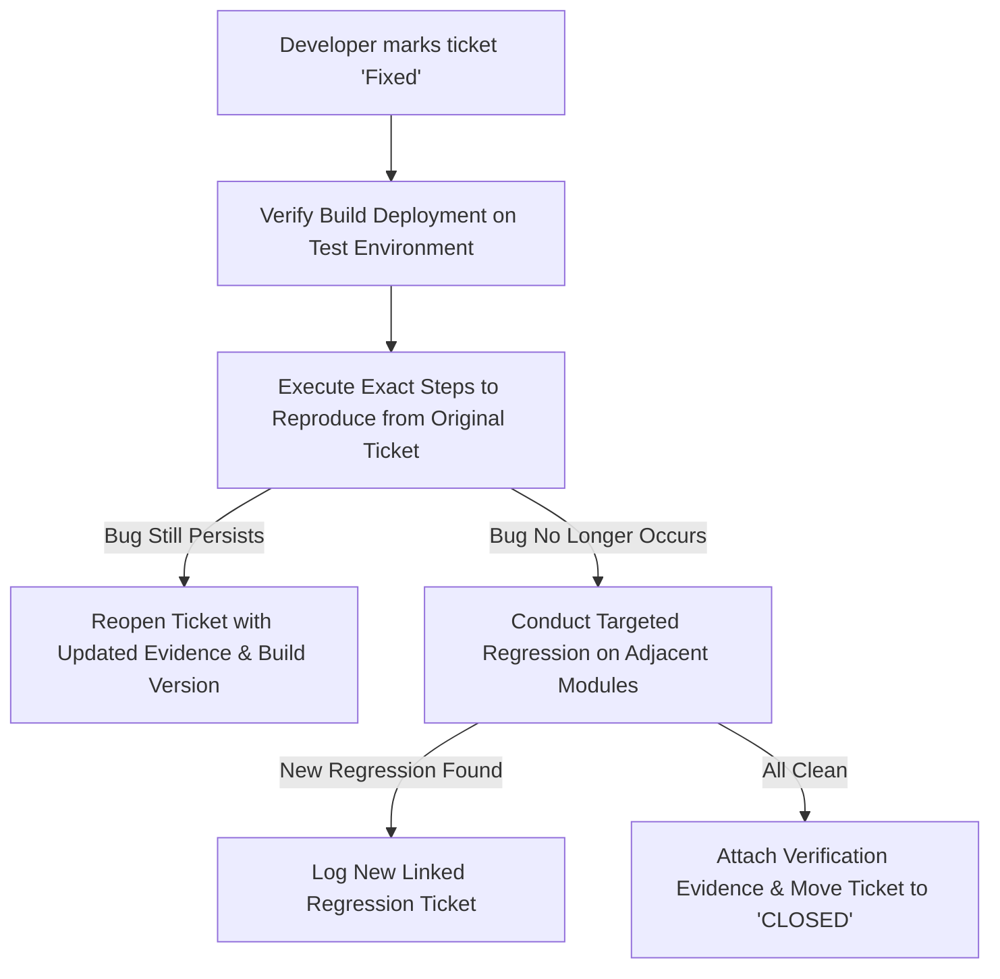

# Defect Triage, Logging, and Verification Lifecycle

A bug report is an engineering document. If a developer cannot reproduce an issue within 60 seconds, the bug report has failed. This guide sets the protocol for bug logging, triage, retesting, and closure.

---

## 1. Anatomy of an Ironclad Bug Report

Every reported defect must follow this standardized schema:

```text
[Bug ID]: [What Happened] on [Where It Occurred] when [Condition / When Triggered]
```

### Mandatory Fields:
1. **Bug ID:** Unique identifier for defect tracking (e.g., `BUG-101`, `QLX-48`).
2. **Summary:** Concise headline using the **What, Where, When** format.
   - *Example:* `App crashes (What) on the Login Screen (Where) when entering an invalid password containing emojis (When).`
3. **Issue Type:**
   - **Functional:** System violates business logic, calculation error, broken API request, or unhandled exception.
   - **GUI (Graphical User Interface):** Visual misalignment, broken responsiveness, overlapping text, wrong branding colors, or missing icons.
4. **Pre-condition:** Initial system prerequisites before step 1 (e.g., *"User logged in with active Freemium plan and cart has 2 items"*).
5. **Steps to Reproduce:** Exact, numbered steps providing precise inputs and click targets.
6. **Expected Result:** Clear, expected system behavior based on specifications.
7. **Actual Result:** Exact observed deviation, including raw error codes or visual defects.
8. **Test Data Used:** Specific accounts, emails, payloads, or files used during testing.
9. **Environment:** OS, device model, browser version, and specific application build number.
10. **Attachments:** Annotated screenshots with red highlight boxes or timestamped screen recordings (`.mp4` / `.gif`).

---

## 2. Severity vs. Priority Decision Matrix

Severity and Priority reflect two distinct dimensions that must never be confused:
- **Severity:** Technical impact on the system stability, data integrity, and security.
- **Priority:** Urgency with which the business must resolve the issue.

```
       HIGH  │  [Low Severity / High Priority]   │  [High Severity / High Priority]
             │  • Misspelled company logo on home│  • Checkout gateway crashes on click
             │  • Executive demo cosmetic bug    │  • Database corruption on sign-up
 P           ├───────────────────────────────────┼─────────────────────────────────
 R           │  [Low Severity / Low Priority]    │  [High Severity / Low Priority]
 I           │  • Tiny padding off by 2px in FAQ │  • App crashes when clicking hidden
 O     LOW   │  • Obscure broken footer link     │    dev button 50 times in 2 seconds
       ──────┴───────────────────────────────────┴─────────────────────────────────
                          LOW                                   HIGH
                                       SEVERITY
```

### Real-World Scenarios:
| Scenario | Severity | Priority | Technical & Business Justification |
| :--- | :---: | :---: | :--- |
| **App crashes when user taps "Buy Now"** | **HIGH** | **HIGH** | System critical path is broken (High Severity) and commercial transactions are completely halted (High Priority). |
| **Company logo on landing page is misspelled or inverted** | **LOW** | **HIGH** | System functions normally with zero technical risk (Low Severity), but presents severe brand damage (High Priority). |
| **Application crashes if user rapidly taps hidden button 50 times** | **HIGH** | **LOW** | Unhandled fatal crash occurs (High Severity), but normal users will practically never trigger this path (Low Priority). |
| **Minor copyright text alignment off by 3px on terms page** | **LOW** | **LOW** | Cosmetic defect that does not affect readability or functionality. Can be addressed in future maintenance sprint. |

---

## 3. Bug Closure & Retesting Protocol

When a developer marks a ticket as **"Resolved"** or **"Fixed"**, QA never closes the ticket immediately. Follow this strict protocol:



1. **Deployment Verification:** Confirm the build version on the test/staging server includes the specific commit or pull request.
2. **Direct Retest:** Execute the exact steps to reproduce recorded in the original ticket using the same test data and environment.
3. **Adjacent Regression Sweep:** Test features directly adjacent to the modified code (e.g., if a payment coupon bug was fixed, test standard card payment, tax calculation, and order confirmation email).
4. **Resolution Documentation:** Add a comment with timestamp, verified build version, and confirming screenshot/log before transitioning to **CLOSED**.

---

## 4. "Cannot Reproduce" (CNR) Investigation Checklist

If a developer flags a bug as unreproducible, provide the following details:
- [ ] **Tested Build Version:** Full semantic version or Git commit SHA.
- [ ] **Exact Test Account:** Specific test user credentials and subscription tier.
- [ ] **State of Local Storage / Cookies:** Whether the issue occurs in Incognito mode with cleared cache.
- [ ] **Network State:** High-speed Wi-Fi vs. Throttled 3G or cellular connection.
- [ ] **Screen Recording:** Full window video capturing URL bar, developer console errors, and click interactions.
- [ ] **Device & OS Specifics:** Exact model number, OS patch version, and screen scale percentage.
