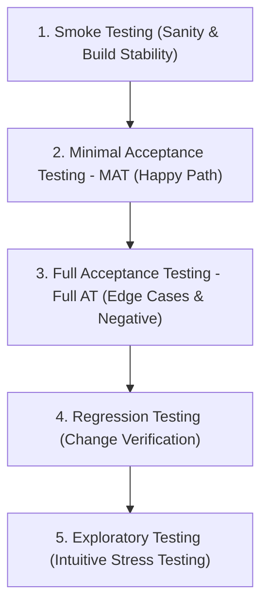

# QA Engineering Methodology & Execution Handbook

This handbook outlines the core principles, test phases, design techniques, and network testing standards applied across web, mobile, and SaaS product audits.

---

## 1. Layered Testing Hierarchy

Testing is approached in successive validation layers, starting from baseline smoke sanity to deep, exhaustive multi-condition checks:

### A. Smoke Testing (Build Sanity)
- **Objective:** Verify core, critical paths immediately upon deployment to ensure the build is not fundamentally broken ("on fire") before allocating deep QA hours.
- **Scope:** Application launch, database connection, user login, primary navigation, and major purchase/submission endpoint.
- **Example:** In an e-commerce platform, ensure the user can sign in, search an item, add to cart, and reach the payment screen.

### B. Minimal Acceptance Testing (MAT - The Happy Path)
- **Objective:** Test end-to-end functionality strictly following standard user workflows with valid inputs.
- **Scope:** 100% positive validation. Ensures that when users behave exactly as expected, the system completes tasks seamlessly.

### C. Full Acceptance Testing (Full AT - Exhaustive Testing)
- **Objective:** Stress-test system resilience by deliberately attempting to break inputs, state machines, and concurrency limits.
- **Key Dimensions:**
 - **Positive & Negative Checks:** Testing valid credentials alongside malformed inputs (e.g., email without `@`, leading spaces, SQL injection strings, excessive character counts).
 - **Edge Cases & Boundary Limits:** Testing values precisely at min/max limits (e.g., uploading files at exactly 25.0 MB when the stated threshold is 25 MB).
 - **Equivalence Partitioning (EP):** Dividing input domains into valid and invalid equivalence classes. Testing one representative value verifies the entire partition.
 - **Boundary Value Analysis (BVA):** Testing three points for every boundary: `Boundary - 1`, `Exact Boundary`, and `Boundary + 1`.
 - **Black-Box Testing:** Exercising the system exclusively from the end-user perspective without internal code insight.

### D. Regression Testing
- **Objective:** Re-executing functional and non-functional test suites to guarantee that recent bug fixes, dependency updates, or code refactors did not introduce new defects into previously stable features.
- **Example:** Re-running full checkout, coupon calculation, and invoice generation flows following a minor cosmetic update to the navigation bar.

### E. Exploratory Testing
- **Objective:** An unscripted, simultaneous learning, test design, and test execution technique. Relies on QA intuition, heuristics, and domain expertise to expose hidden defect clusters.
- **Example:** Rapidly switching between Wi-Fi and mobile data during an ongoing file upload while simultaneously pressing the device back button.

---

## 2. Network Resilience & Real-World Condition Testing

Software must perform reliably across degraded, intermittent, or high-latency network conditions.

### A. Mobile Network Testing
- **Procedure:** Disconnect from high-speed Wi-Fi and conduct test runs using real cellular carrier data.
- **Network Toggle:** Manually switch device settings across **2G (EDGE)**, **3G (HSPA)**, and **4G/5G** to observe application timeout policies, retry mechanisms, and loading skeleton states.
- **Interruption Testing:** Simulate connection loss mid-transaction (airplane mode toggle or elevator conditions) to verify offline caching, graceful error banners, and idempotency.

### B. Web Browser Network Throttling
- **Tool:** Chrome / Firefox Developer Tools (`Network` tab &rarr; `Throttling` dropdown).
- **Profiles Used:**
 - **Fast 3G:** 1.6 Mbps download, 750 Kbps upload, 560 ms RTT.
 - **Slow 3G:** 500 Kbps download, 500 Kbps upload, 2000 ms RTT.
 - **Custom Profiles:** Packet drop simulation and offline transition tests.
- **Key Observation Criteria:**
 - Are double-click race conditions prevented on submit buttons via debouncing?
 - Do timeout handlers display actionable retry prompts rather than unhandled white screens?

---

## 3. Test Documentation Strategy

| Documentation Type | Project Scale | Best For | Format |
| :--- | :--- | :--- | :--- |
| **Formal Test Cases** | Enterprise / Long-term | Detailed, repeatable, step-by-step verification; team handoffs. | Excel / Jira Test Management (Xray / Zephyr) |
| **Acceptance Sheets** | Agile / Medium sprints | High-level checklist grouping multiple criteria into feature-level Pass/Fail statuses. | Spreadsheet / Notion / Confluence |
| **Rapid Exploratory Bug Logging** | Fast-paced startups | Time-critical builds; skipping script writing to directly test and log bugs in Jira. | Jira / GitHub Issues with screen recordings |
